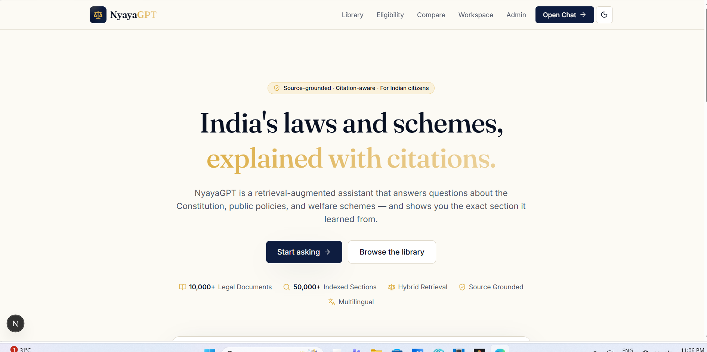
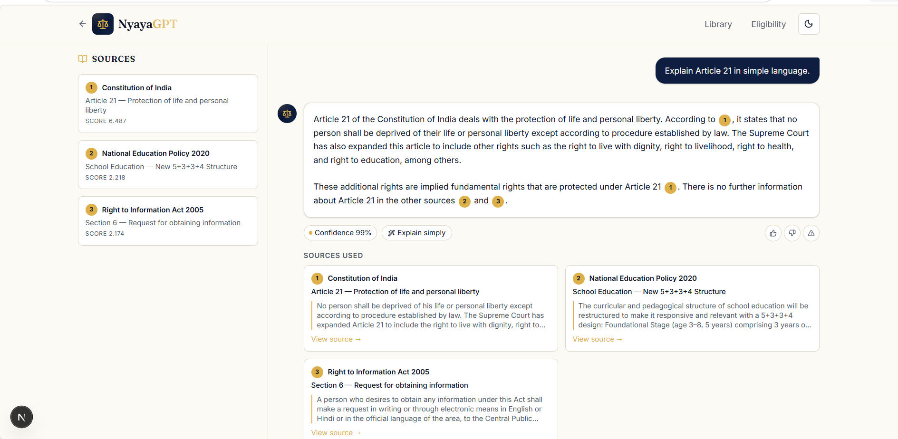
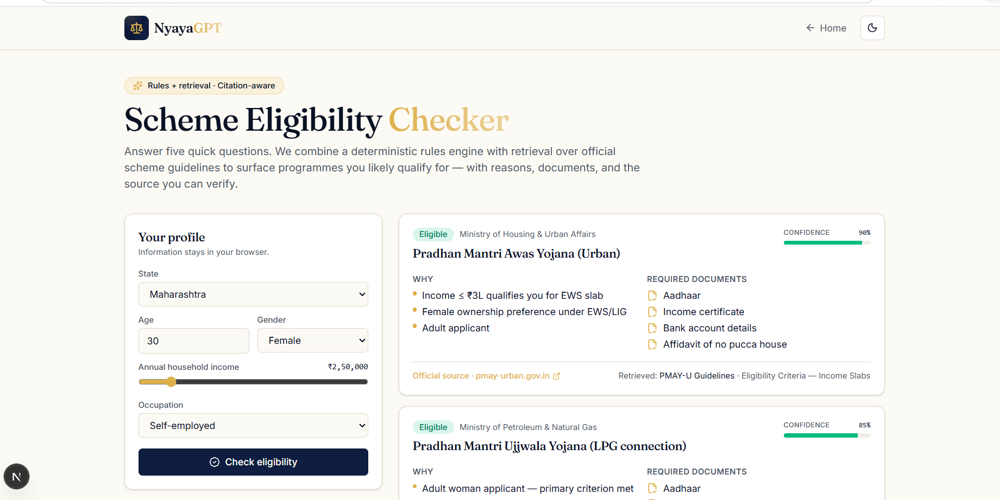

# NyayaGPT — AI-Powered Legal & Civic Intelligence Platform

> India's laws and schemes, explained with citations.

NyayaGPT helps Indian citizens understand laws, government policies, constitutional provisions and welfare schemes using **Retrieval-Augmented Generation (RAG)**.

Every answer is grounded in sources retrieved on the server and carries inline citations, so users can check the response against the linked legal sections.


## 📸 Screenshots

<div align="center">
  
  <br/>
  <em>NyayaGPT Landing Page</em>
  <br/><br/>
  
  <br/>
  <em>RAG Chat with Citations and Explain Simply</em>
  <br/><br/>
  
  <br/>
  <em>Scheme Eligibility Checker Rules Engine</em>
</div>

## ✨ Key Features

| Feature | Description |
|---------|-------------|
| 🔍 **RAG Chat** | Ask legal questions; get answers with inline [1][2] citations and a retrieval trace |
| 📚 **Legal Library** | Browse the indexed acts, policies, and constitutional articles |
| ✅ **Eligibility Checker** | Rule-based check for 8 government welfare schemes |
| ⚖️ **Policy Comparison** | Compare two policies side-by-side with export to Markdown |
| 🔎 **Hybrid retrieval** | BM25 keyword search + multilingual vector search, merged with Reciprocal Rank Fusion |
| 🗣️ **Multilingual** | Ask in English, Hindi or Punjabi. Semantic search matches non-English questions to the English corpus, and the model replies in your language |
| 📝 **Explain Simply** | Rewrite an answer in plain language |
| 📊 **Admin Dashboard** | Dashboard UI with **simulated** metrics (not connected to real usage data) |
| 🔐 **Admin Auth** | HMAC-signed, httpOnly session cookie, checked server-side by middleware |

## 🏗️ Architecture

The whole app is a single Next.js application; there is no separate backend or database.

```
NyayaGPT/
├── frontend/                 # Next.js 15 (App Router) + Tailwind CSS
│   ├── src/app/              # Pages (/, /chat, /library, /eligibility, /compare, /workspace, /admin, /login)
│   ├── src/app/api/          # Route handlers: chat, simplify, auth/login, auth/logout, retrieval-status
│   ├── src/middleware.ts     # Protects /admin with the signed session cookie
│   ├── src/instrumentation.ts# Loads the embedding model at server start
│   ├── src/components/       # Reusable UI components
│   ├── src/data/corpus.ts    # Seed legal corpus
│   ├── src/lib/              # BM25, embeddings, hybrid fusion, RAG context builder, signing, sessions, rate limiting
│   └── src/store/            # Zustand state (workspace bookmarks persist in localStorage)
├── docker-compose.yml        # Runs the app in a container
└── README.md
```

### Request flow

1. The browser sends only the question to `POST /api/chat`.
2. The server runs **hybrid retrieval** (see below), picks the top 3 sections, and sends them to an LLM on Groq with an "answer only from these sources" prompt.
3. The response includes the answer, citations, a confidence heuristic, the retrieval trace, and an HMAC signature of the answer.
4. `POST /api/simplify` only accepts answers carrying a valid signature, so neither endpoint can be used as a general-purpose LLM proxy.
5. Both endpoints are rate-limited per IP and globally (in-memory; use a shared store such as Redis if you run multiple instances).

Without `GROQ_API_KEY`, the chat returns built-in demo answers.

### Hybrid retrieval

| Stage | Detail |
|-------|--------|
| Keyword | BM25 over the corpus (top 5 hits) |
| Semantic | [`multilingual-e5-small`](https://huggingface.co/Xenova/multilingual-e5-small) embeddings, run locally with `@huggingface/transformers` (ONNX). Hits need cosine similarity ≥ 0.775 (top 5) |
| Fusion | Reciprocal Rank Fusion (k = 60); exact ties prefer sections with semantic support |
| Fallback | If the model is unavailable or takes longer than 4 s, that request uses BM25 only. The trace shows which mode ran |

- The model (~120 MB) downloads from Hugging Face on first start and is cached in `frontend/.cache/models`; the Docker image bakes it in at build time.
- The 0.775 threshold was calibrated on this corpus: relevant questions (English paraphrases, Hindi, Punjabi) scored a best match of 0.779–0.876, off-topic questions 0.734–0.769. Re-calibrate if you change the model or corpus.
- **Windows:** the native ONNX runtime needs the [Microsoft Visual C++ Redistributable (x64)](https://learn.microsoft.com/cpp/windows/latest-supported-vc-redist). Without it, the app runs in BM25-only mode.
- Retrieval status (`hybrid`, `bm25` or `warming`) is shown on the admin dashboard and at `GET /api/retrieval-status`.

## 🚀 Quick Start

```bash
cd frontend
cp .env.example .env.local   # optional for local dev
npm install
npm run dev
```

Open [http://localhost:3000](http://localhost:3000)

### With Docker

```bash
# Create a .env file next to docker-compose.yml (see below), then:
docker compose up --build
```

## 🔑 Environment Variables

See [`frontend/.env.example`](frontend/.env.example).

| Variable | Required | Purpose |
|----------|----------|---------|
| `GROQ_API_KEY` | No | Enables AI answers. Get one at [console.groq.com](https://console.groq.com). Without it, demo answers are used |
| `GROQ_MODEL` | No | Groq model ID (default `openai/gpt-oss-120b`). See the models available to your key at `GET https://api.groq.com/openai/v1/models` |
| `HYBRID_RETRIEVAL` | No | Set to `off` to use BM25 only (no model download) |
| `EMBEDDING_MODEL` | No | Hugging Face embedding model (default `Xenova/multilingual-e5-small`) |
| `EMBEDDING_CACHE_DIR` | No | Where models are cached (default `.cache/models`) |
| `HYBRID_MIN_SIMILARITY` | No | Vector similarity threshold (default `0.775`) |
| `ADMIN_USERNAME` | No | Admin username (default `admin`) |
| `ADMIN_PASSWORD` | In production | Admin password. In development only, `admin123` is used if unset. In production, admin login is disabled until it is set |
| `SESSION_SECRET` | In production | At least 32 characters. Signs admin sessions and chat answers. Generate with `node -e "console.log(require('crypto').randomBytes(32).toString('base64url'))"` |

## 🎨 Design Language

- **Style**: Minimalist, premium LegalTech aesthetic
- **Typography**: Fraunces (display) + Inter (body) from Google Fonts
- **Colors**: Deep navy primary (#0F234B), Regal gold accent (#D9B45A), Warm parchment background (#F8F7F3)
- **Dark Mode**: Full dark mode support with OKLCH color system

## 📚 Indexed Legal Corpus

The corpus is a small, hand-curated set of summaries and excerpts, not the full text of each act.

| Document | Year | Sections |
|----------|------|----------|
| Constitution of India | 1950 | Articles 14, 15, 19, 21, 32, 368 |
| RTI Act | 2005 | Sections 4, 6, 7, 8 |
| DPDP Act | 2023 | Sections 5–6, 9, 11–12, 33 & Schedule |
| PMAY-U 2.0 | 2024 | Eligibility, Interest Subsidy Scheme |
| PMAY-U (2015, historical) | 2015 | Eligibility (CLSS, closed), Components |
| MGNREGA | 2005 | Sections 3 & 7, Schedule I, Section 17 |
| NEP 2020 | 2020 | 5+3+3+4 Structure, Higher Ed, Technology |
| Ayushman Bharat PM-JAY | 2018 | Coverage, Eligibility (incl. 70+ expansion, 2024) |

## 🛠️ Tech Stack

| Layer | Technology |
|-------|-----------|
| Framework | Next.js 15 (App Router, route handlers, middleware), TypeScript |
| Styling | Tailwind CSS |
| Animations | Framer Motion |
| State | Zustand |
| Charts | Recharts |
| Icons | Lucide React |
| AI/LLM | Groq (`openai/gpt-oss-120b` by default; override with `GROQ_MODEL`) |
| Retrieval | Hybrid: BM25 (in-memory) + multilingual-e5-small embeddings (local ONNX), fused with RRF |
| Deployment | Vercel, or Docker (standalone Next.js output) |

## 📄 License

This project is for educational and informational purposes. Not legal advice.

---

Built with ❤️ for Indian citizens · Powered by Retrieval-Augmented Generation
